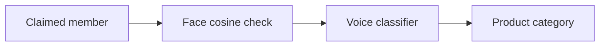

# Face and voice gated product recommendation

A claimed member must pass face verification, then voice verification, before the system recommends a product category from that member's purchase history.



- **Face.** `facial_recognition_model/face_predictor.py` embeds a photograph with EdgeFace-XXS and accepts the claim when cosine similarity to the stored neutral and smile embedding is at least `0.534`. Enrollment is stored in `facial_recognition_model/image_features.csv`, built by `facial_recognition_model/facial_rec.ipynb`. The first check downloads the weights from the `otroshi/edgeface` repository through `torch.hub`.
- **Voice.** `voice_verification/voice_verification.py` loads a clip at 16 kHz, extracts MFCCs and spectral features, and accepts it when the saved classifier is confident, the speaker is not the `unknown` class, and the speaker matches the claimed member. `voice_verification/train_voice_model.py` fits a random forest and a logistic regression with leave-one-clip-out evaluation and saves the stronger model to `voice_model.joblib`.
- **Product.** `product_model_project/product_predictor.py` builds features from `product_model_project/merged_dataset.csv` and returns the top product categories. Member names are linked to customer ids in `system_demo.py`. The datasets have no names, so this link is an assumption, chosen because those customers have several past transactions.

| Member | Customer id |
| --- | --- |
| blessing | 161 |
| davy | 159 |
| gabriella | 187 |
| kagaba | 188 |

## Layout

```text
system_demo.py                          end-to-end demo
facial_recognition_model/
  face_predictor.py                     verify a photograph
  facial_rec.ipynb                      align, augment, and embed photographs
  eda.ipynb                             merge checks for the customer tables
  image_features.csv                    saved face embeddings
  images/                               enrolled photographs and augmentations
voice_verification/
  voice_verification.py                 load, augment, featurize, and verify audio
  build_audio_features.py               plots, augmented wavs, audio_features.csv
  train_voice_model.py                  train and save voice_model.joblib
  demo_check.py                         genuine clips against unseen outsiders
  voice_verification_notebook.ipynb     same pipeline, run from this folder
  data/audio/                           enrolled clips
  data/audio_unauthorized/              outsider clips used in training
  data/demo_clips/                      outsider clips held out of training
  data/audio_aug/                       augmented clips
product_model_project/
  data_merge.py                         join transactions and social profiles
  product_model.py                      compare models and save product_model.joblib
  product_predictor.py                  recommend a category for one customer
  product_recommendation_section.ipynb  merge, exploration, and modelling
  merged_dataset.csv                    saved joined table
```

`image_features.csv`, `voice_model.joblib`, `product_model.joblib`, and `merged_dataset.csv` are already saved, so the demo runs without retraining.

## Setup

The project uses Python 3.14 and the packages in `Pipfile`.

```bash
pipenv install
pipenv shell
```

Install these in the same environment as well. Voice verification imports `librosa`. Rebuilding the augmented clips imports `soundfile`. Training the product model imports `xgboost`.

```bash
pipenv install librosa soundfile xgboost
```

The first face check needs a network connection so `torch.hub` can fetch EdgeFace.

## Run

From the repository root:

```bash
python system_demo.py demo
python system_demo.py demo --pause
python system_demo.py interactive
python system_demo.py members
```

`demo` runs the six scenarios below. `--pause` waits for Enter between them. `interactive` lets you test face, voice, product prediction, or a full transaction on your own files. On Windows it plays the submitted clip; elsewhere it prints the path. Face checks open the photograph in the default image viewer.

One transaction:

```bash
python system_demo.py run \
  --member blessing \
  --face facial_recognition_model/images/blessing_neutral.jpg \
  --voice voice_verification/data/audio/blessing_confirm_01.wav
```

Each stage on its own:

```bash
python facial_recognition_model/face_predictor.py blessing \
  facial_recognition_model/images/blessing_neutral.jpg

python voice_verification/demo_check.py blessing

cd product_model_project
python product_predictor.py 161
```

`product_predictor.py` reads `merged_dataset.csv` and `product_model.joblib` from the working directory, so run it from `product_model_project/`.

## Scripted demo

| Scenario | What it checks |
| --- | --- |
| Blessing's photograph and voice | An enrolled member is granted and a product is predicted |
| Davy's photograph and voice | A second enrolled member is granted |
| Davy's photograph claiming to be Blessing | A face mismatch stops the transaction before voice or product |
| Blessing's photograph with Kellia's voice | An outsider heard in training is denied at voice |
| Blessing's photograph with an unseen outsider clip | A recording held out of training is denied at voice |
| Gabriella's photograph with Kagaba's voice | A voice that belongs to a different member is denied |

## Rebuild

Face embeddings come from the notebook. Re-run `facial_recognition_model/facial_rec.ipynb` to regenerate `image_features.csv`.

Voice features and the saved classifier:

```bash
cd voice_verification
python build_audio_features.py
python train_voice_model.py
```

`build_audio_features.py` writes waveform and spectrogram plots, augmented wav files, and `audio_features.csv`. `train_voice_model.py` writes `voice_model_results.csv` and `voice_model.joblib`.

Customer table and product model:

```bash
cd product_model_project
python data_merge.py
python product_model.py
```

`data_merge.py` joins the transaction and social-profile CSVs into `merged_dataset.csv`. `product_model.py` compares a majority baseline, logistic regression, a random forest, and XGBoost with grouped cross-validation, keeps the lowest log loss, and writes `product_model.joblib` and `product_model_results.csv`.
